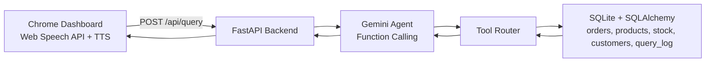

# VoiceOps

İşletmeler için depo içi sesli operasyon asistanı. Depo çalışanı Chrome üzerinden Türkçe konuşur; React Web Speech API ile sesi metne çevirir, FastAPI komutu Gemini function calling ile işler, SQLite demo verisini sorgular veya stok günceller, yanıtı ekranda ve Türkçe TTS ile verir.

## MVP Özeti

- FastAPI + Python backend
- Gemini function calling agent
- SQLite + SQLAlchemy demo veri katmanı
- React + Vite + Tailwind dashboard
- Web Speech API STT ve SpeechSynthesis TTS
- 30 sipariş, 25 ürün, müşteri, stok ve konuşma geçmişi seed verisi

  ## Demo ve Sunum

- Demo Video: https://youtu.be/LeW9xG2TdmA
- Pitch Deck: VoiceOps_pitchdeck.pdf

## En Kolay Kurulum

Repo kökünde tek seferlik setup:

```bash
npm run setup
```

Root `.env` içine Gemini key ekleyin. `backend/.env` oluşturmanız gerekmez:

```bash
GEMINI_API_KEY=your_gemini_api_key
```

Sonra tüm uygulamayı tek komutla başlatın:

```bash
npm run dev
```

Uygulama: [http://127.0.0.1:5173](http://127.0.0.1:5173)  
API docs: [http://127.0.0.1:8000/docs](http://127.0.0.1:8000/docs)

## Alternatif Manuel Çalıştırma

Backend ve frontend'i ayrı terminallerde açmak isterseniz:

```bash
npm run backend
```

```bash
npm run frontend
```

Demo verisini sıfırlamak için:

```bash
npm run reset-db
```

## Elle Komutlarla Kurulum

Script kullanmadan kurmak isterseniz repo kökünde:

```bash
python3 -m venv .venv
source .venv/bin/activate
pip install -r requirements.txt
cp .env.example .env
```

`.env` içine Gemini key ekleyin:

```bash
GEMINI_API_KEY=your_gemini_api_key
```

Backend:

```bash
cd backend
python -m app.seed --reset
uvicorn app.main:app --reload
```

Frontend:

```bash
cd ../frontend
npm install
npm run dev
```

Uygulama: [http://localhost:5173](http://localhost:5173)  
API docs: [http://localhost:8000/docs](http://localhost:8000/docs)

## Komutlar

```bash
npm run setup      # Python ve frontend bağımlılıklarını kurar
npm run set-key    # Gemini key'i gizli prompt ile .env dosyasına yazar
npm run dev        # Backend + frontend birlikte açılır
npm run backend    # Sadece FastAPI açılır
npm run frontend   # Sadece React/Vite açılır
npm run reset-db   # Demo verisini 30 sipariş + 25 ürüne sıfırlar
npm run doctor     # Env/dependency kontrolü yapar, key'i yazdırmaz
npm run test       # Backend testleri, frontend lint ve build
```

## Klasör Bazlı Çalıştırma

Script kullanmadan backend'i başlatmak isterseniz:

```bash
cd backend
../.venv/bin/python -m app.seed
../.venv/bin/uvicorn app.main:app --reload --host 127.0.0.1 --port 8000
```

Script kullanmadan frontend'i başlatmak isterseniz:

```bash
cd frontend
npm install
npm run dev -- --host 127.0.0.1 --port 5173
```

## Demo Komutları

- `105 numaralı sipariş nerede?`
- `Domatesten kaç kilo kaldı?`
- `Domatesten 5 kilo düş`
- `Bugün kaç sipariş geldi?`
- `Kritik stokta ne var?`
- `Bekleyen siparişler hangileri?`

## Mimari



## API

- `POST /api/query` - ses transcript komutunu işler.
- `GET /api/orders?limit=10` - son siparişleri listeler.
- `GET /api/stock?critical_only=false` - stok durumunu listeler.
- `GET /api/history?limit=10` - konuşma geçmişini listeler.
- `PATCH /api/stock/{product_id}` - manuel/debug stok güncellemesi.

## Test

```bash
npm run test
```

Testlerde Gemini canlı çağrısı yapılmaz; agent mock'lanır. Gerçek demo için yalnızca `GEMINI_API_KEY` gereklidir.

## Notlar

- Gemini API key backend tarafında kalır, frontend'e verilmez.
- Demo için masaüstü Chrome önerilir; Web Speech API desteği tarayıcıya göre değişir.
- `.env` dosyaları commitlenmez. Örnek değerler `.env.example` içinde tutulur.
